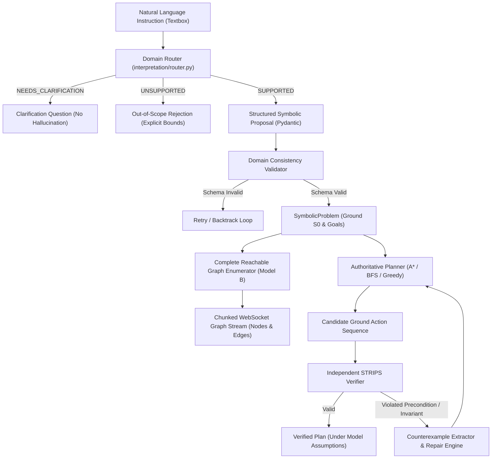

# RE-PLAN-V: System Architecture & Technical Specification

## 1. System Overview

RE-PLAN-V is an extensible, text-first neuro-symbolic planning and formal verification platform. The system operates on the core principle of **asymmetric authority**:
- **Neural Models (LLMs)** interpret unconstrained natural language instructions, extracting candidate entities, initial condition hypotheses, goal specifications, and negative safety constraints.
- **Symbolic Planning Engines** own domain semantics, state transitions, state-space search, invariant verification, diagnostic counterexample generation, and constraint-guided repair. Under no circumstances is a plan accepted based on neural assertion alone.

---

## 2. Core Subsystems

### 2.1 Generic Domain Framework (`core/domains/`)
- **`BaseDomain` (`core/domains/base.py`)**: Abstract base class defining declarative action schemas, preconditions, positive/negative STRIPS effects, state invariants, goal satisfaction tests, and canonical SHA-256 state hashing.
- **`DomainRegistry` (`core/domains/registry.py`)**: Thread-safe registry maintaining all registered planning domains and providing introspectable metadata summaries for frontend studios.
- **Canonical Domains**:
  1. `blocks_world`: Classical 4-operator stacking with table/clear physics.
  2. `grid_world`: 2D discrete coordinate navigation and item transfer.
  3. `household`: Domestic robotics covering room topology, container doors, and surface placement.
  4. `warehouse`: AGV logistics routing between racks, pick zones, and SKU storage.
  5. `scheduling`: Discrete machine allocation with DAG precedence constraints.
  6. `software_workflow`: Gated CI/CD release pipeline with test and security approvals.

### 2.2 Complete State-Space Graph Explorer (`core/graph/`)
- **`CompleteReachableGraphEnumerator` (`core/graph/enumerator.py`)**:
  - Implements Model B: Complete Reachable-State Graph exploration.
  - Worklist BFS with exact semantic state deduplication via SHA-256 canonical fact hashing.
  - Detects cycles without infinite expansion.
  - Identifies dead-end states (states with no outgoing valid actions and unsatisfied goals).
  - Enforces strict budgets (`max_nodes`, `max_edges`, `timeout_seconds`).
  - Sets truthful completeness status: `is_complete = True` only when the entire reachable frontier is exhausted; otherwise sets `is_complete = False` and documents the exact `truncation_reason`.
- **`AlgorithmSearchTracer` (`core/graph/tracer.py`)**:
  - Records the actual search expansions and frontier operations of specific algorithms (`A*`, `BFS`, `Greedy Best-First`).
  - Kept strictly distinct from complete state-space enumeration.

### 2.3 Text-First NLP Domain Router (`interpretation/router.py`)
- Categorizes natural language instructions into the 6 supported canonical domains.
- Detects missing facts and issues `NEEDS_CLARIFICATION` without silently inventing world states (e.g., does not assume unknown items are on a table).
- Rejects out-of-scope tasks with `UNSUPPORTED` (e.g., quantum computing, fluid dynamics).
- Preserves negative constraints ("do not touch", "avoid", "never move").

### 2.4 Authoritative Search & Verification (`core/search/`, `core/verification/`)
- **Planners**: `A*` with admissibility-tested RPG heuristic, `BFS` for unit-cost exploration, and `Greedy Best-First`.
- **Independent Verifier**: Simulates ground action execution step-by-step against domain preconditions and invariants.
- **Fault Attribution & CEGIS**: Extracts minimal counterexample witnesses upon violation and synthesizes scoped state-action repair constraints.

### 2.5 API & Streaming Layer (`app/api/`)
- **REST Endpoints**:
  - `GET /api/domains`: Full metadata and action signatures for all 6 domains.
  - `POST /api/graph/enumerate`: Standalone state-space enumeration returning Cytoscape elements.
  - `POST /api/pipeline/run`: Synchronous execution endpoint with full diagnostic trace.
- **WebSocket Protocol (`/ws/pipeline`)**:
  - Streams chunked node batches (`GRAPH_NODE_BATCH`) and edge batches (`GRAPH_EDGE_BATCH`).
  - Isolates per-run state with zero singleton leakage.
